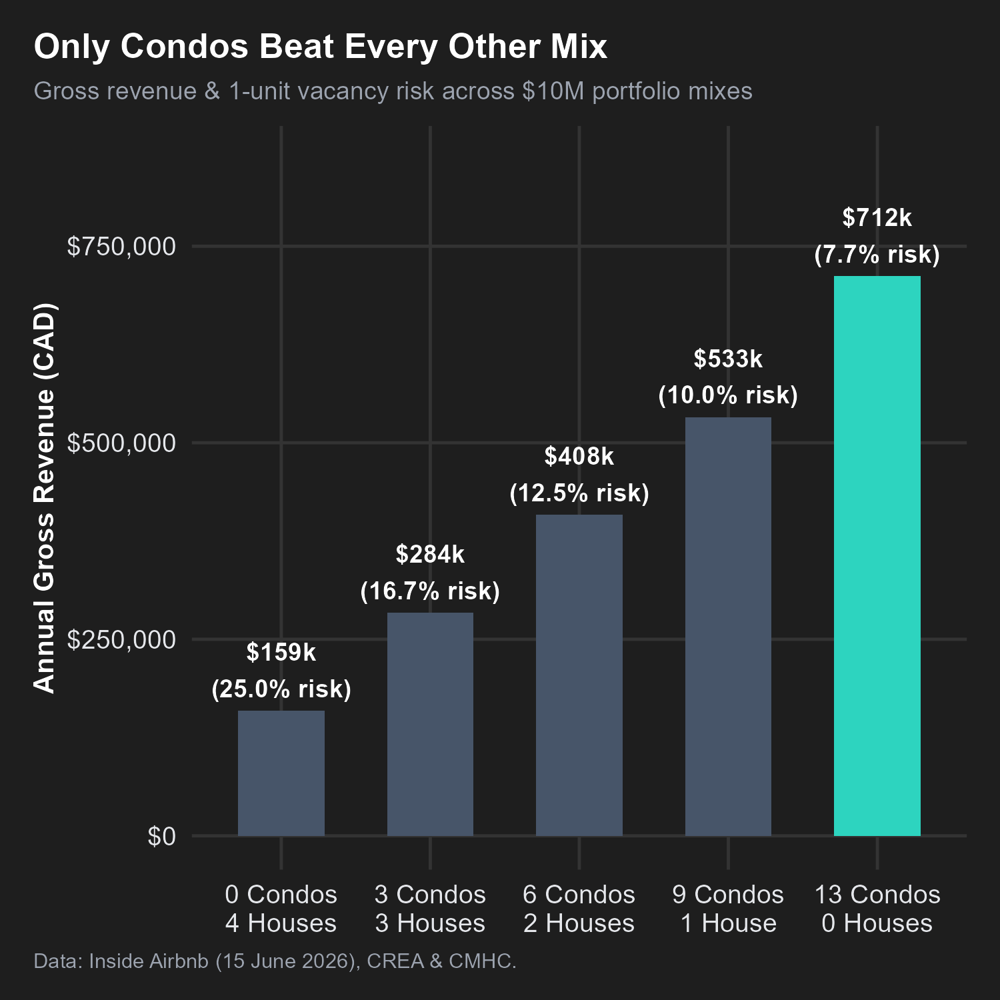
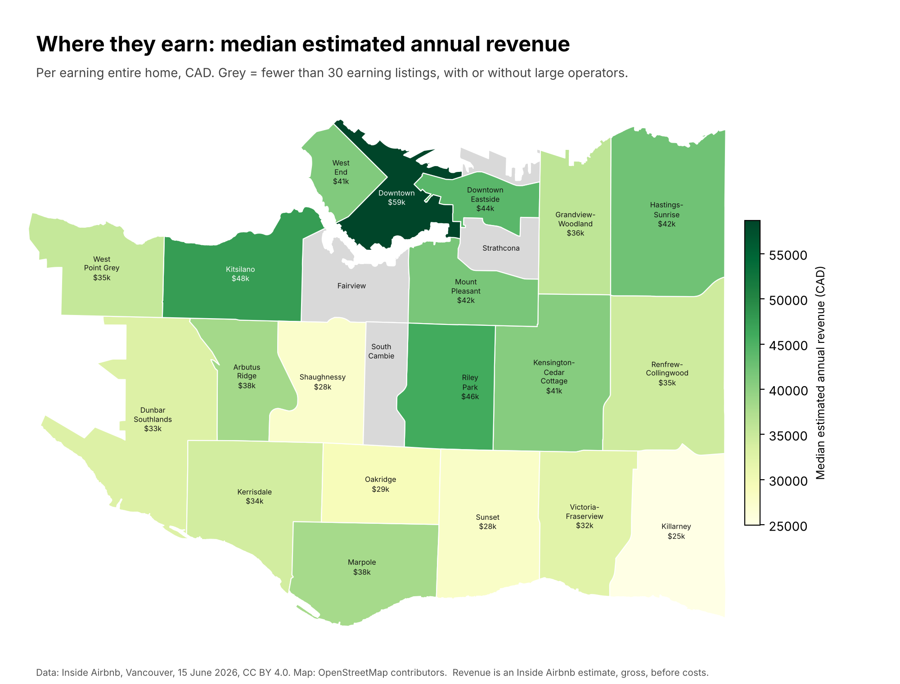

# DataJam 2026 – The Airbnb Vancouver Problem

## **Project Overview**
This project analyses short-term rental listings in **Vancouver** to evaluate potential real estate investment opportunities for a hypothetical **$10 million CAD** investment fund (*Data-Driven Developments*).

The goal is to identify promising property types and investment strategies by examining *estimated rental revenue*, *property acquisition costs*, and *potential portfolio performance*.

The analysis uses **Inside Airbnb** listing data and additional housing price information to estimate potential investment performance.

## **Requirements**
The project uses **Python 3** and the following Python library:
- *pandas*

The project also uses **R** and the following R libraries:
- *tidyverse*
- *httr2*
- *scales*

## **How to Run Python Files**
1. **Revenue Analysis:**
   `python3 Analysis/01_revenue_analysis.py`

2. **Property Acquisition Cost Analysis:**
   `python3 Analysis/02_property_costs.py`

3. **Portfolio Analysis:**
   `python3 Analysis/03_portfolio_analysis.py`

## **Outputs**
Analysis results are saved in `Analysis/Outputs`.

*You can run the R files from RStudio.*

## **Presentation Charts**
All **6** charts and maps used in the pitch are organized in [`Presentation_Charts/`](Presentation_Charts/).

### *Portfolio Mix & Vacancy Risk (13 Condos vs. 4 Houses)*

### *Median Estimated Annual Revenue by Neighbourhood*

